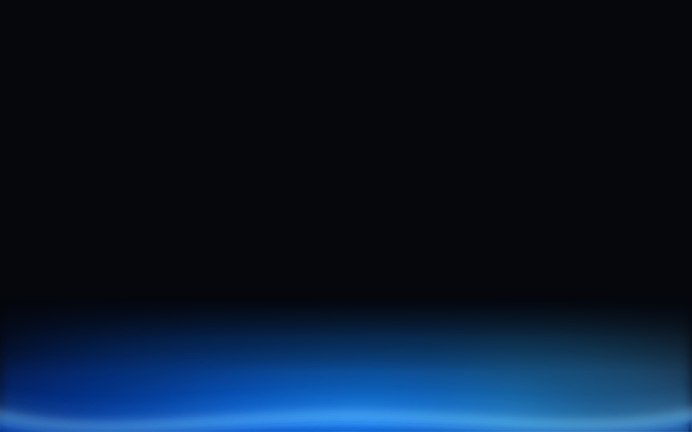

# Clyra – full-width blue voice glow

`ClyraCallGlow` (`src/ClyraCallGlow.tsx` + `.css`) wraps [`voice-glow`](https://libraries.dev/voice.html)'s `VoiceBeam`
into a single full-width blue ambient glow along the bottom of the screen.

This repo is a **blank-page harness**: no call UI, it just cycles the glow through
*blank → open → listening → thinking → speaking → interrupted → thinking → speaking → call ended*.
Pin a mode with `?phase=listening|thinking|speaking`; `?mic=1` uses your real microphone for listening (analysis only).

## Integrating into Clyra
```tsx
<ClyraCallGlow open={callActive} phase={callPhase}
  getMicLevel={micLevel} getTtsLevel={ttsLevel} getWordPulse={wordPulse /* optional */} />
```
Mount it once in an application-level layer so the exit fade finishes after the call screen unmounts.
`createAudioLevelGetter(analyser)` (`src/audioLevel.ts`) turns an existing `AnalyserNode` into the getters.
`src/demoAudio.ts` is demo-only (a formant voice through an analyser) and is not imported by the component.

## Screenshots
| | |
|-|-|
|  |  |
|  |  |
|  |  |

## Develop
`npm i && npm run dev` · `npm run typecheck` · `npm run build`
